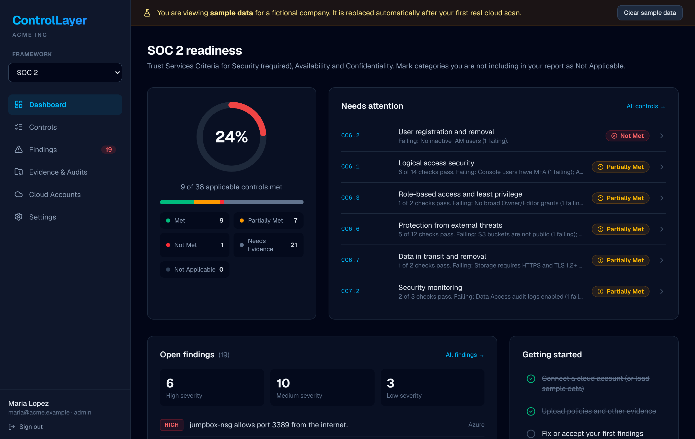
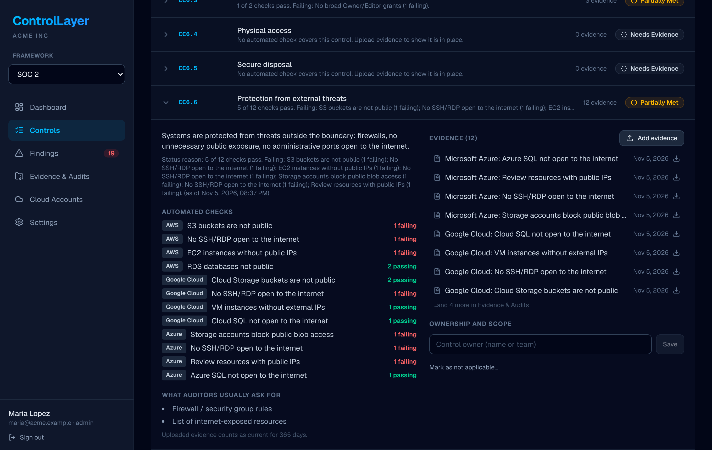
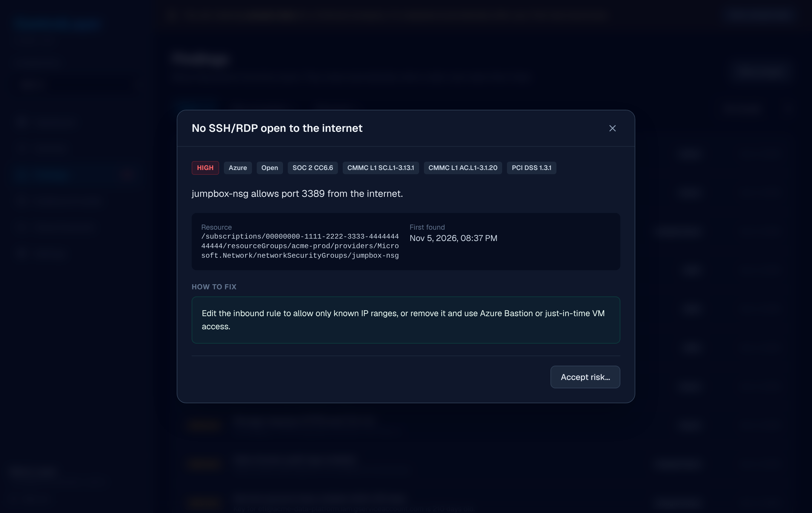
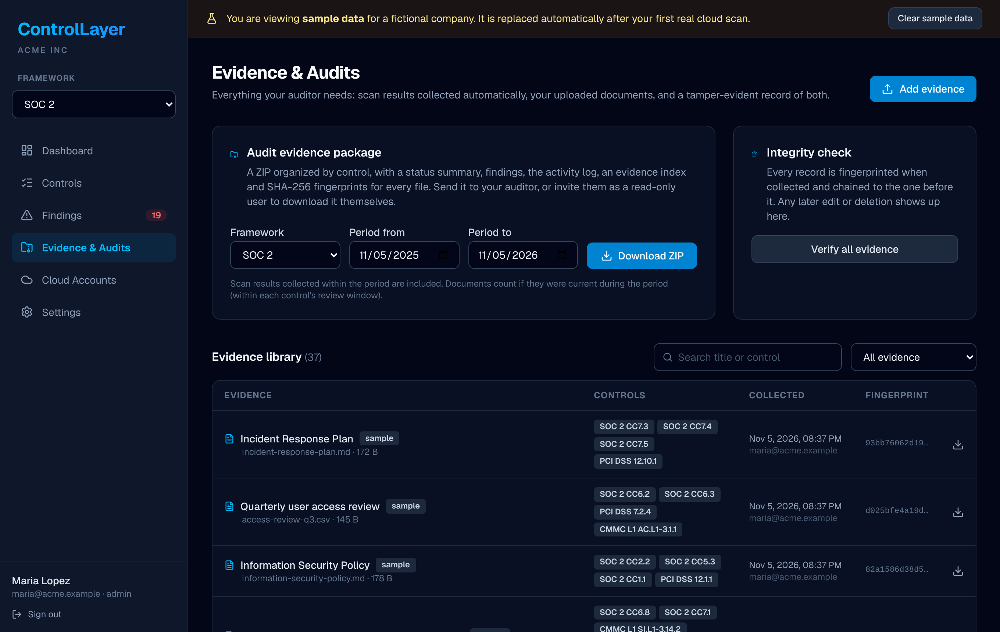
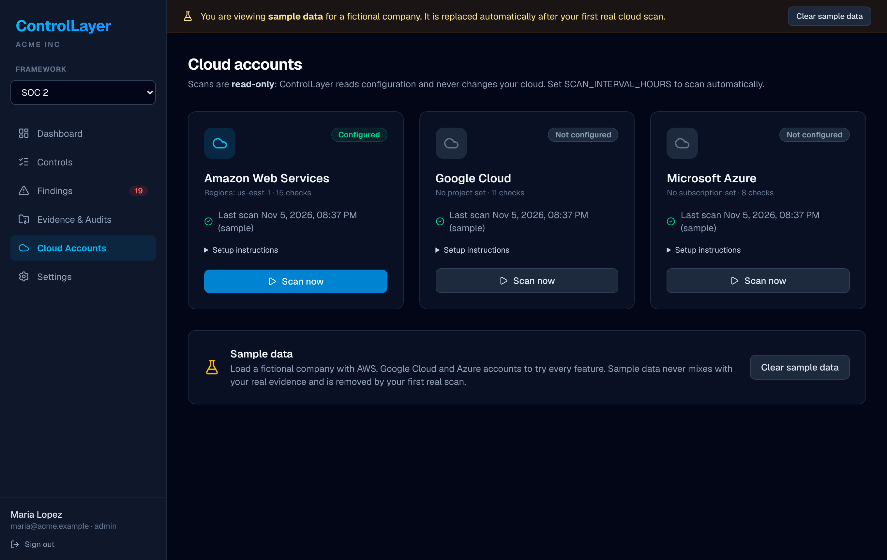

# ControlLayer

**Open-source continuous compliance and audit evidence for small teams.**

ControlLayer scans your AWS, Google Cloud and Azure accounts, maps what it finds to SOC 2, CMMC and PCI DSS controls, and collects the evidence your auditor will ask for. When the audit starts, you hand over a single package organized control by control, or give your auditor a read-only login.

It is built for companies without a compliance team: self-hosted, read-only by default, and free.



## What it does

- **Continuous cloud checks.** 34 read-only checks across AWS, Google Cloud and Azure: MFA, inactive users, key rotation, public storage, open SSH/RDP, encryption, audit logging, backups and more.
- **Framework mapping.** Each check is mapped to every control it supports, so one scan updates SOC 2, CMMC and PCI DSS at once.
- **Evidence collection for auditors.** Every scan result is stored as dated evidence. Upload policies, screenshots, access reviews and other documents and link them to controls. Each control lists what auditors typically request.
- **Audit evidence package.** One click produces a ZIP for a framework and audit period: a control status summary, findings (including accepted risks), the activity log, an evidence index, and a folder per control with its evidence.
- **Tamper-evident records.** Evidence is fingerprinted (SHA-256) when collected and linked in a hash chain. The integrity check, and every export, shows whether anything was changed or deleted afterward.
- **Findings that close themselves.** Failing resources become findings with step-by-step fixes. They resolve automatically when a later scan sees them fixed, or you can accept the risk with a documented reason.
- **Auditor access.** Three roles: admin, member, and auditor (read-only, can download evidence).
- **Sample company.** Load realistic sample data for all three clouds to explore everything before connecting an account.

## Frameworks

| Framework | Coverage | Controls | Automated by cloud checks |
| :--- | :--- | :--- | :--- |
| **SOC 2** (Trust Services Criteria 2017, rev. 2022) | Security, Availability, Confidentiality | 38 | 11 |
| **CMMC 2.0 Level 1** | All 17 practices | 17 | 10 |
| **PCI DSS v4.0** | Preview: core requirements | 25 | 15 |

Controls not covered by a cloud check (policies, training, vendor management, physical security) are met by uploading current evidence. Each control has a review window (for example 365 days for policies, 90 days for access reviews) after which it asks for fresh evidence. Mark any control you are not including in scope as *Not Applicable* with a reason, which is included in the audit package.

HIPAA and GDPR are on the roadmap.

## Screenshots

| Controls | Findings |
| :---: | :---: |
|  |  |
| **Evidence & Audits** | **Cloud accounts** |
|  |  |

## Quick start (Docker)

You need Docker with Compose.

```bash
git clone https://github.com/nicholasmagner/ControlLayer-SOC-2-GRC-Analyst.git controllayer
cd controllayer
cp .env.example .env          # set ORGANIZATION_NAME and cloud credentials here
docker compose up -d --build
```

Open <http://localhost:3000> and create the first admin account. Then load the sample data, or connect a cloud account under **Cloud Accounts**.

Database migrations run automatically when the container starts. Uploaded evidence is stored in PostgreSQL, so back up the `postgres_data` volume.

For anything beyond a laptop, put ControlLayer behind HTTPS (for example Caddy, nginx or a cloud load balancer that sends `X-Forwarded-Proto: https`), change `POSTGRES_PASSWORD`, and remove the database port mapping from `docker-compose.yml`.

## Connecting cloud accounts

Scans only read configuration. Use a dedicated identity with read-only permissions:

| Cloud | Permissions | Settings (`.env`) |
| :--- | :--- | :--- |
| **AWS** | Managed policy `SecurityAudit` | `AWS_ACCESS_KEY_ID` / `AWS_SECRET_ACCESS_KEY`, or `AWS_PROFILE`, or an IAM role on the host. `AWS_REGIONS=us-east-1,us-west-2` |
| **Google Cloud** | `Viewer` + `Security Reviewer` on the project | `GCP_PROJECT_ID`, plus `GOOGLE_APPLICATION_CREDENTIALS` (service account key) or an attached service account |
| **Azure** | `Reader` + `Security Reader` on the subscription | `AZURE_SUBSCRIPTION_ID`, plus `AZURE_TENANT_ID` / `AZURE_CLIENT_ID` / `AZURE_CLIENT_SECRET` or a managed identity |

Restart the app after changing credentials, then click **Scan now**. If a permission is missing, the scan still runs everything it can and lists the sections it could not read. Those checks are reported as not evaluated, never as passing.

The first real scan automatically removes the sample data.

### Scheduled scans

Set `SCAN_INTERVAL_HOURS=24` to scan every configured account daily while the server runs. Alternatively, run `npm run scan` from cron or a scheduled job. It exits non-zero if a scan fails.

## Preparing for an audit

1. **Scope.** Pick your framework in the sidebar and mark controls outside your audit scope as Not Applicable, with a reason.
2. **Fix.** Work through **Findings**, starting with High severity. Accept risks you won't fix, with a reason.
3. **Document.** For each control showing *Needs Evidence*, upload what the control lists under "What auditors usually ask for". One document can support several controls and frameworks.
4. **Assign owners** to controls so everyone knows who keeps evidence current.
5. **Invite your auditor** under **Settings** with the *Auditor* role. They can review everything and download packages, but cannot change anything.
6. **Export.** Under **Evidence & Audits**, choose the framework and audit period and download the package. Record the *chain head* printed in its `README.txt`; a later package whose chain still contains it shows that earlier evidence was not altered.

## Running locally for development

Requirements: Node.js 22+, PostgreSQL 15+ (or `docker compose up -d db`).

```bash
npm install
cp .env.example .env              # DATABASE_URL points at the compose database on port 5433
npm run db:migrate                # create tables
npm run db:seed                   # load the framework catalog (SEED_SAMPLE_DATA=true to add sample data)
npm run dev                       # http://localhost:3000
```

| Command | What it does |
| :--- | :--- |
| `npm test` | Unit tests (checks, evidence chain, audit package, scoring, auth helpers) |
| `npm run lint` / `npm run typecheck` | ESLint / TypeScript |
| `npm run build` | Production build |
| `npm run scan [aws gcp azure]` | Scan configured accounts from the command line |
| `node scripts/screenshots.mjs URL` | Regenerate the README screenshots (needs Playwright) |

## Configuration

All settings are environment variables; see [`.env.example`](./.env.example).

| Variable | Purpose |
| :--- | :--- |
| `DATABASE_URL` | PostgreSQL connection string (required) |
| `ORGANIZATION_NAME` | Shown in the app and on audit packages |
| `SCAN_INTERVAL_HOURS` | Automatic scans while the server runs |
| `AWS_*`, `GCP_*`, `GOOGLE_APPLICATION_CREDENTIALS`, `AZURE_*` | Cloud credentials (see above) |
| `ENABLE_AWS_REMEDIATION` | Lets admins apply a "require MFA" IAM policy to an AWS user from a finding. **This is the only feature that changes a cloud account**; it is off by default and needs `iam:PutUserPolicy`. |
| `ASSISTANT_API_KEY`, `ASSISTANT_MODEL` | Optional assistant that explains controls and drafts audit narrative from your data. It can only read and answer; pass/fail always comes from the checks. Off when unset. |
| `SECURE_COOKIES` | Force HTTPS-only session cookies (automatic behind an HTTPS proxy) |

## How it works

```
cloud APIs ──► connectors (read-only)  ──► normalized inventory
                                               │
                                               ▼
                                      checks (pure functions)
                                               │
              ┌────────────────────────────────┼─────────────────────────────┐
              ▼                                ▼                             ▼
     findings (open / resolve)       evidence (hash-chained)      control status per framework
                                               │
                                               ▼
                                   audit package (ZIP + manifest)
```

- `src/frameworks/`: control catalogs (SOC 2, CMMC, PCI DSS) with expected evidence.
- `src/connectors/`: AWS, Google Cloud and Azure collectors, plus the sample company.
- `src/checks/`: checks over the normalized inventory, each mapped to framework controls. They don't call cloud APIs, so they are unit-tested directly.
- `src/scan/`: runs a scan, records results, opens and closes findings, stores evidence.
- `src/assessment/`: deterministic control status (Met, Partially Met, Not Met, Needs Evidence, Not Applicable).
- `src/evidence/`: hash chain, integrity verification and the audit package builder.

### Adding a check

Add an entry to `src/checks/aws.ts`, `gcp.ts` or `azure.ts` with the controls it maps to. If it needs data that isn't collected yet, extend the inventory type and its collector in `src/connectors/`. Add a test in `src/checks/checks.test.ts`. The test suite fails if a check maps to a control that doesn't exist.

### Adding a framework

Create `src/frameworks/<name>.ts` following `soc2.ts`, register it in `src/frameworks/index.ts`, and add its control IDs to the relevant checks. The control table syncs on startup.

## Security notes

- Scans use read-only permissions; the only write action (`ENABLE_AWS_REMEDIATION`) is opt-in and admin-only.
- Passwords are hashed with scrypt; sessions are random tokens stored hashed; sign-in attempts are rate limited.
- Mutating requests require a same-site session cookie and are rejected from other origins.
- Uploaded files are always served as downloads, never rendered in the browser.
- The evidence chain is tamper-*evident*, not tamper-proof: someone with direct database access could rebuild it, which is why the chain head is printed in every export for you and your auditor to record.

Please report vulnerabilities privately; see [SECURITY.md](./SECURITY.md).

## Roadmap

- HIPAA Security Rule and GDPR catalogs; full PCI DSS and ISO 27001
- Identity and SaaS connectors: Google Workspace, Microsoft 365 / Entra ID, Okta, GitHub
- Policy templates and annual review reminders
- Evidence request lists that auditors can comment on
- Single sign-on (SAML / OIDC)

## Contributing

Contributions are welcome. See [CONTRIBUTING.md](./CONTRIBUTING.md).

## License

[MIT](./LICENSE)

ControlLayer helps you prepare for audits; it does not certify compliance. Framework descriptions are plain-language summaries. Refer to the official standards (AICPA Trust Services Criteria, CMMC, PCI DSS) for authoritative wording.
