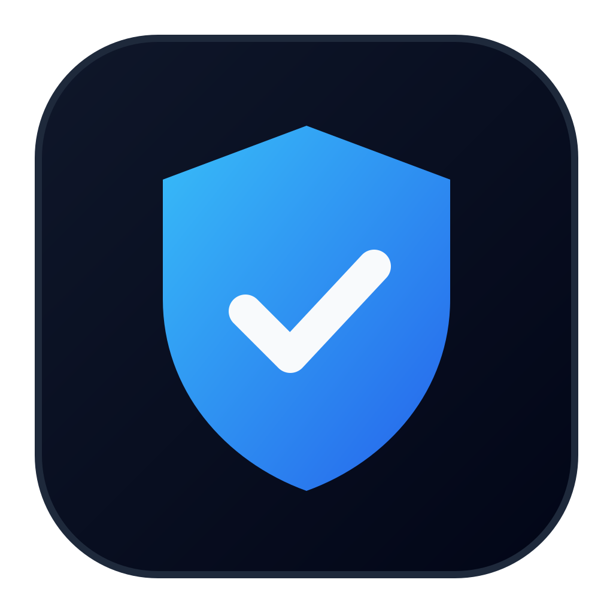
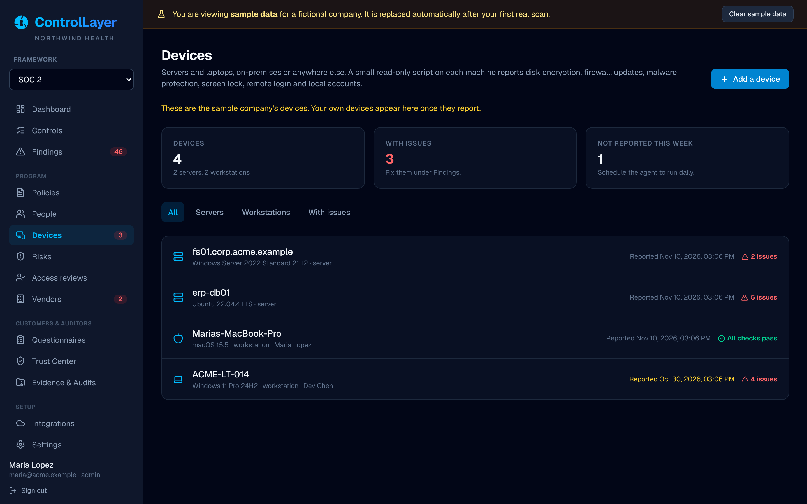
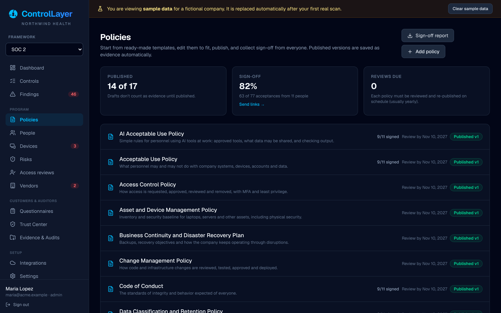
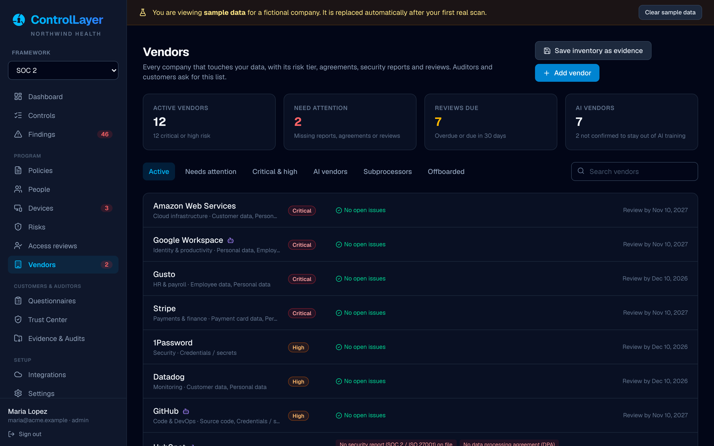
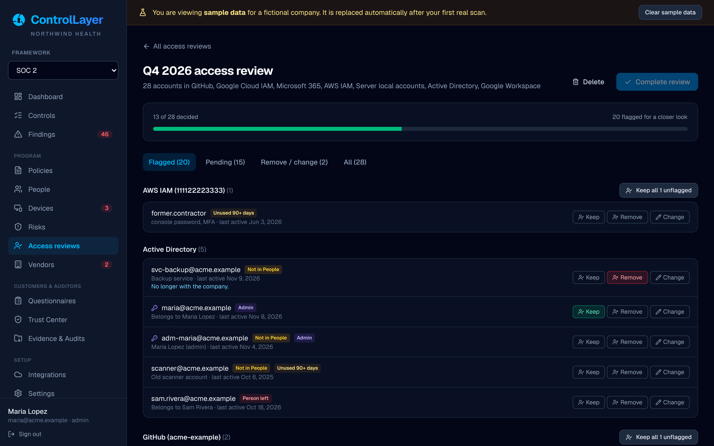
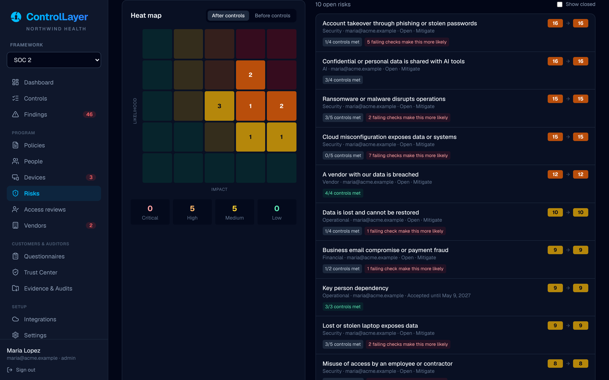
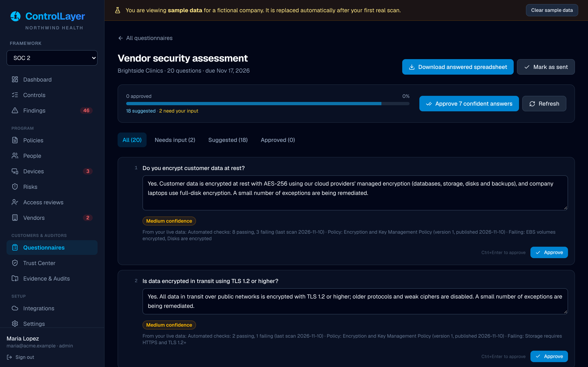
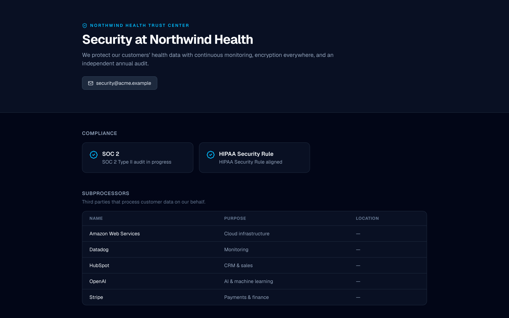
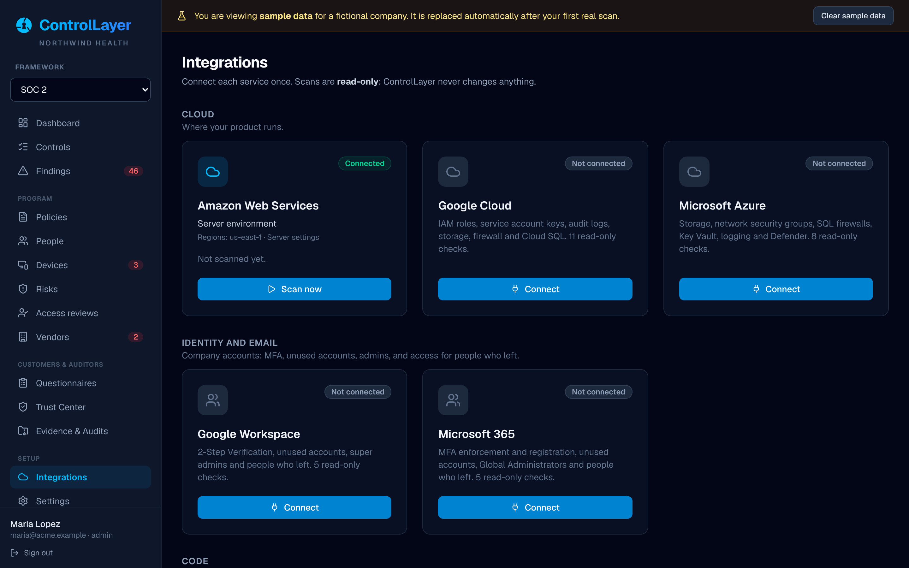

<div align="center">



# ControlLayer

**Open-source compliance automation for teams without a compliance team.**

Continuous monitoring, policies, vendor and risk management, access reviews, security questionnaires and audit-ready evidence for SOC 2, ISO 27001, HIPAA and more. Self-hosted, read-only and free.

[](https://github.com/nicholasmagner/control-layer/actions/workflows/ci.yml)
[](./LICENSE)
[](https://github.com/nicholasmagner/control-layer/releases/latest)

[**Download**](https://github.com/nicholasmagner/control-layer/releases/latest) · [**Quick start**](#get-started) · [**Features**](#features) · [**Frameworks**](#frameworks) · [**Docs**](#documentation)

<br>


</div>

## Why ControlLayer

Getting a SOC 2 report or answering a customer's security review usually means an expensive compliance platform, a pile of spreadsheets, or both. ControlLayer does the same job for free, on your own infrastructure.

- **Connect once, stay ready.** Read-only connections to your cloud, identity and code platforms, plus your own servers and laptops. Checks run continuously, and every result is saved as dated evidence.
- **One set of evidence, eight frameworks.** Work toward SOC 2 and get most of ISO 27001, HIPAA and the rest along the way. Each check, policy and review is mapped once and counts everywhere it applies.
- **The whole program, not just the scans.** Policies with employee sign-off, vendor risk management, access reviews, a risk register and customer questionnaires all live in one place, and each one leaves an audit trail.
- **Evidence an auditor can trust.** Every record is fingerprinted, hash-chained and independently timestamped, so nobody can quietly change or backdate it. Hand over one package, organized control by control.
- **Your data stays yours.** Run it on a server or as a desktop app. Your compliance data never leaves your infrastructure (independent timestamps send only a fingerprint), and scans never change your systems.

## Features

### Continuous monitoring

66 read-only checks across AWS, Google Cloud, Azure, Google Workspace, Microsoft 365, Active Directory, GitHub, and your servers and laptops: MFA, inactive and former employees' accounts, key rotation, public storage, open SSH and RDP, encryption, audit logging, backups, code review, secret scanning and more. Failing resources become findings with step-by-step fixes, and they close themselves when the next scan sees the fix.

<table>
<tr>
<td width="50%"></td>
<td width="50%"></td>
</tr>
<tr>
<td align="center"><b>Controls</b>: live status, the checks behind it, and what auditors usually ask for</td>
<td align="center"><b>Findings</b>: what failed, where, and exactly how to fix it</td>
</tr>
</table>

### Servers and laptops, on-premises or anywhere

A small, read-only script for Linux, Windows and macOS reports disk encryption, firewall, updates, malware protection, screen lock, remote login settings, logging, password rules and local accounts. Run it once or every day, or push it with Group Policy, Intune, Jamf or Ansible. ControlLayer never connects to your machines; they report in over HTTPS. Active Directory is checked over LDAP.



### Policies with employee sign-off

17 policy templates written for small companies, including information security, access control, incident response, business continuity, privacy, responsible AI and AI acceptable use. They're already mapped to framework controls. Edit, publish, and send each person a personal link to read and accept them, with no account needed. Every version and every acceptance is kept as evidence.



### Vendor risk management

A vendor inventory with automatic risk tiers based on the data each vendor can reach, and a catalog of 72 common vendors to add in one click. ControlLayer tracks SOC 2 reports, DPAs and BAAs with their expiry dates and checks whether AI vendors train on your data. It also sends vendors a security questionnaire they answer without an account, records reviews as evidence, and publishes your subprocessor list.



### Access reviews

Quarterly access reviews built from the real accounts in Google Workspace, Microsoft 365, Active Directory, GitHub, AWS, Google Cloud and your servers, or from any system via CSV. Accounts belonging to people who left, unknown owners, unused accounts and admins are flagged for a closer look. Decisions are saved as evidence, and later scans confirm that removed access is actually gone.



### Risk register

Start from a library of 30 common risks, including AI risks, or let ControlLayer suggest them from your failing checks and vendors. Each risk shows a before-and-after heat map, the live status of the controls that treat it, and any formal risk acceptance with an expiry date. The yearly risk assessment is saved as evidence in one click.



### Security questionnaires, answered from live data

Upload a customer's questionnaire as Excel or CSV. ControlLayer answers it from what it actually knows: passing checks, published policies, sign-off rates, vendors, risks and your Trust Center. Each answer shows its confidence and sources. Approve or edit the answers, then download the customer's own spreadsheet with them filled in. Your edits are remembered for next time.



### Trust Center

A public page with your compliance status, the security practices your latest scans verify, your policies and your subprocessors. Share your SOC 2 report through time-limited links you approve, after the requester accepts your NDA terms.



### Evidence and audits

Every scan result, policy version, review and upload is stored as dated, fingerprinted evidence. For audits that need screenshots, ControlLayer generates dated images of each check's results, so a Type II audit period has a dated series. When the audit starts, download a ZIP for any framework and period, organized control by control. You can also give your auditor a read-only login.

<table>
<tr>
<td width="50%"></td>
<td width="50%"></td>
</tr>
<tr>
<td align="center"><b>Evidence & Audits</b>: tamper-evident library and one-click audit package</td>
<td align="center"><b>Integrations</b>: sign in with your browser or use a read-only key</td>
</tr>
</table>

## Frameworks

| Framework | Coverage | Controls | Checked automatically | Covered by policy templates |
| :--- | :--- | ---: | ---: | ---: |
| **SOC 2** (Trust Services Criteria) | Security, Availability, Confidentiality | 38 | 13 | 36 |
| **ISO/IEC 27001:2022** | All Annex A controls | 93 | 20 | 65 |
| **HIPAA Security Rule** | Administrative, physical and technical safeguards | 35 | 10 | 29 |
| **GDPR** | Preview: key obligations | 16 | 1 | 14 |
| **CMMC 2.0 Level 1** | All 17 practices | 17 | 12 | 16 |
| **PCI DSS v4.0** | Preview: core requirements | 25 | 17 | 22 |
| **ISO/IEC 42001:2023** (AI management) | All Annex A controls | 38 | – | 23 |
| **NIST AI RMF 1.0** | All 19 categories | 19 | – | 13 |

Controls without an automated check are met by your published policies and by the records ControlLayer keeps: vendor reviews, access reviews, the risk assessment, policy sign-off and uploaded documents. See the [audit guide](./docs/audit-guide.md#how-controls-are-assessed) for details.

## Integrations

| Category | Services |
| :--- | :--- |
| **Cloud** | AWS, Google Cloud, Microsoft Azure |
| **Identity & email** | Google Workspace, Microsoft 365, Active Directory (on-premises) |
| **Code** | GitHub |
| **Servers & laptops** | Linux, Windows and macOS through the device agent |
| **Anything else** | CSV import for people and access reviews; document upload for any evidence |

Every connection is read-only. Missing permissions are reported as "not evaluated", never as passing.

## Get started

### Desktop app (easiest)

Download the installer for **macOS, Windows or Linux** from the [latest release](https://github.com/nicholasmagner/control-layer/releases/latest), install it and open it. Everything is included, database too, and your data stays on your computer. Load the sample company to explore every feature before connecting anything.

### Docker (for your team and your auditor)

```bash
git clone https://github.com/nicholasmagner/control-layer.git controllayer
cd controllayer
cp .env.example .env          # set ORGANIZATION_NAME and CONTROLLAYER_SECRET_KEY
docker compose up -d --build
```

Open <http://localhost:3000>, create the first admin account, and either load the sample data or connect a service under **Integrations**. For anything beyond a laptop, run it behind HTTPS and change the database password. [Setup guide →](./docs/setup.md)

## Documentation

| Guide | What's in it |
| :--- | :--- |
| [Setup](./docs/setup.md) | Connecting each service and the permissions it needs, the device agent, scheduled scans, configuration |
| [Audit guide](./docs/audit-guide.md) | From first scan to handing your auditor the evidence package |
| [Development](./docs/development.md) | Running from source, architecture, adding checks and frameworks |
| [Desktop app](./desktop/README.md) | How the desktop app is built and where it keeps your data |

## Security

- Scans only read configuration. The one optional write action (a one-click AWS fix) is off by default and admin-only.
- Passwords are hashed with scrypt, sessions are hashed random tokens, and sign-in is rate limited.
- Evidence is tamper-*evident*: fingerprinted with SHA-256, hash-chained, and timestamped by an independent RFC 3161 authority. Auditors can verify the timestamps themselves with `openssl`.
- Sign-off, Trust Center and vendor links are random, hashed tokens; Trust Center links expire and every download is logged.

Please report vulnerabilities privately; see [SECURITY.md](./SECURITY.md).

## Roadmap

- Browser extension for one-click, stamped screenshots of any admin console
- Full PCI DSS and GDPR catalogs; EU AI Act obligations
- Connectors for Okta, GitLab, Jira, HR systems and device management (MDM)
- Security awareness training tracking and email reminders
- Single sign-on (SAML / OIDC)

Ideas and pull requests are welcome; see [CONTRIBUTING.md](./CONTRIBUTING.md).

## License

[MIT](./LICENSE). Evidence images use the Inter typeface (SIL Open Font License, see `assets/fonts/`).

ControlLayer helps you prepare for audits; it does not certify compliance. A SOC 2 report must come from an independent CPA firm. Framework descriptions are plain-language summaries; refer to the official standards for authoritative wording.
